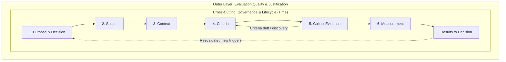

# A Complete Guide to AI Evaluation

**AI evaluation** is the systematic inquiry that collects and interprets evidence about an AI model, system, its use, or its effects, against explicit questions and criteria, to inform understanding or support a decision.

Evaluation can test whether a model solves a problem, whether a product behaves appropriately, or whether people benefit from using it. These questions require different evidence and support different conclusions. A benchmark score, an expert’s judgment, and a measured improvement in someone’s work each establish something different.

> [!NOTE]
> **Status of this framework:** The architecture in this guide is a proposed synthesis developed to organize evaluation concerns. It is not a recognized standard, an established industry taxonomy, an empirically validated theory, or a guarantee of completeness. Its value should be judged by whether it helps teams formulate better questions, uncover omissions, obtain credible evidence, and make defensible decisions.

Throughout this guide, distinguish three kinds of statements:

- **Empirical claims:** statements about what observations, tests, or studies show.
- **Conceptual and normative choices:** definitions, priorities, requirements, and judgments about acceptable consequences.
- **Practical recommendations:** proposed procedures whose suitability depends on the application, consequences of error, available evidence, and resources.

A systematic procedure can still measure the wrong thing, overlook affected people, or support an overextended conclusion. Confidence should therefore depend on the evidence and argument supporting a specific interpretation and use.

---

## Part I: The Evaluation Landscape & Conceptual Foundations

### 1. Architecture of the Guide

An evaluation practice sits within a broader intellectual and operational landscape:

| Component | Central question |
|---|---|
| **Conceptual, theoretical, and normative foundations** | What do the concepts mean, why do they matter, and what would justify claims about them? |
| **Evaluation objects, scopes, and contexts** | What arrangement is being assessed, for whom, and under which conditions? |
| **Capabilities, properties, and outcomes** | What specifically are we trying to understand or assess? |
| **Evaluation design, methods, and inference** | How will evidence be obtained, analyzed, and connected to the intended claims? |
| **Evaluation engineering** | How will collection, execution, scoring, versioning, and reporting be implemented? |
| **Interpretation, use, and decisions** | Which conclusions and actions does the evidence support? |

Three cross-cutting concerns apply across every component:

- **Evaluation quality and justification:** the adequacy of concepts, evidence, measurements, assumptions, and conclusions.
- **Governance:** participation, authority, independence, resources, and accountability.
- **Lifecycle and time:** how findings and procedures should be revisited as systems and contexts change.

#### The Practical Flow

In day-to-day work, these concerns connect through ten practical dimensions. The numbers identify dimensions, not a rigid one-way sequence: early observations may reshape criteria, an ambiguous result may call for a different study, and a newly discovered harm may alter the permitted scope. Measurement procedures should also be considered during study design, even though scoring occurs after evidence is collected.

| Element | Core question |
|---|---|
| **1. Purpose & decision** | What do we need to learn, and what decision will it inform? |
| **2. Scope** | What exactly are we evaluating? |
| **3. Context** | For whom, on which tasks, under which conditions? |
| **4. Criteria** | What would count as success, failure, benefit, or harm? |
| **5. Collect evidence** | Which observations, tests, or studies can answer the question? |
| **6. Measurement** | How will we turn that evidence into interpretable judgments? |
| **7. Time (Lifecycle)** | When should we evaluate again, and what may have changed? |
| **8. Evaluation quality** | What conclusions can this evaluation credibly support? |
| **Governance** | Who sets the terms, participates, reviews, and remains accountable? |
| **Results to decision** | Given the findings and limitations, what action is justified? |

*Reference:* NIST similarly describes its AI risk-management functions as iterative, with governance applying across the other functions. That supports this general organization without validating its exact arrangement.

---

### 2. Conceptual, Theoretical, and Normative Foundations

Before measuring a property, clarify what you mean by it and why the proposed observations would be informative. Terms such as *reasoning*, *understanding*, *helpfulness*, *fairness*, *safety*, and *alignment* have multiple interpretations. Naming a construct does not establish that it has been defined or measured.

Different disciplines contribute different foundations:

| Discipline or area | Contribution |
|---|---|
| **Cognitive science** | Theories and evidence about cognition, learning, reasoning, perception, and behavior. |
| **Logic and formal methods** | Explicit accounts of inference, consistency, specifications, and proof obligations. |
| **Linguistics (semantics, pragmatics, and discourse)** | Analysis of language structure, meaning, interpretation, context, communicative intent, and sociolinguistic variation. |
| **Ontology engineering and domain modeling** | Explicit domain concepts, distinctions, relations, and constraints. |
| **Measurement theory and psychometrics** | Relationships between constructs, observations, scores, and their interpretations. |
| **Statistics and experimental design** | Sampling, estimation, uncertainty, comparison, and design-based inference. |
| **Causal inference** | Assumptions and designs needed to investigate effects and alternative explanations. |
| **Epistemology and philosophy of science** | Analysis of evidence, justification, explanation, generalization, and competing hypotheses. |
| **Human–computer interaction and social research** | Evidence about situated use, experience, collaboration, and organizational consequences. |
| **Domain expertise, ethics, and safety/security engineering** | Contextual requirements, consequential failure modes, affected interests, and acceptable constraints. |

Match the depth of conceptual work to the claim. A simple schema-validation check does not require philosophical analysis; a broad claim about reasoning or social benefit does.

#### Behavioral Capability vs. Mechanistic Explanation

Consider a reasoning evaluation. Four questions arise:
1. Which conception of reasoning is relevant?
2. Which tasks provide evidence about it?
3. Which alternative explanations could produce similar performance?
4. What would distinguish those explanations?

Correct answers may reflect a bounded reasoning capability, or they may reflect memorized examples, shortcuts, tool assistance, or other processes. Correctness alone generally underdetermines the underlying mechanism. Separate a **behavioral capability claim** from a **mechanistic explanation**—the latter usually requires additional evidence and explicit testing of alternatives.

#### Normative Choices

Foundations also include value judgments. Evidence can estimate the consequences of different privacy rules or error thresholds, but it cannot by itself determine which consequences people should accept. Those choices require explicit normative reasoning and accountable participation.

> **Practical output:** A concept-and-claim statement defining the target, its importance, relevant theory, observable indicators, and plausible alternative interpretations.

---

## Part II: Framing What You Are Evaluating

### 3. Purpose, Questions, and Evaluation Modes

“Evaluate this AI” is too broad to guide a study. Begin with the uncertainty that matters and the decision or understanding it informs:

- Characterizing a capability or limitation.
- Distinguishing competing explanations.
- Comparing models or system configurations.
- Diagnosing a recurring failure.
- Testing whether a modification improves performance.
- Deciding whether to deploy, restrict, mitigate, or discontinue a system.
- Assessing consequences for people, workflows, or institutions.

A useful evaluation question names the **system**, **task**, **population**, **comparator**, **desired outcome**, and **relevant constraints**. For example:

> *For researchers comparing empirical papers, does this version of the assistant improve the quality of their completed evidence syntheses compared with their existing workflow, without increasing unsupported conclusions?*

This question asks for more than summary accuracy: it asks about completed human work against an explicit baseline. Google’s *People + AI Guidebook* makes the underlying principle explicit: identify the user need, understand the existing workflow, and question whether AI adds value over simpler alternatives.

#### Exploratory vs. Confirmatory Modes

| Mode | Main purpose | Treatment of criteria and analysis |
|---|---|---|
| **Exploratory** | Discover failures, user needs, patterns, or plausible explanations. | Criteria, definitions, and analyses can develop as evidence is examined. |
| **Confirmatory** | Test a specified claim or decision rule. | Main outcomes, comparisons, analyses, and thresholds are fixed *before* inspecting the confirmatory results. |

Both modes are legitimate. Problems arise when criteria are repeatedly tuned to the same dataset and the resulting analysis is presented as an independent test. “Setting thresholds early” means establishing decision rules before examining the confirmatory evidence to which they apply, while leaving room for documented revision during exploration.

> **Practical output:** A short evaluation brief stating the question, decision, intended claim, comparator, constraints, and what evidence could change the team’s mind.

---

### 4. Scope and Unit of Analysis

Scope identifies the object or arrangement being evaluated:

| Scope | Example question |
|---|---|
| **Model** | Can the model correctly interpret the methods described in a paper? |
| **Component or subsystem** | Does retrieval find the relevant methodological passages? |
| **Complete AI system or product** | Do retrieval, model, prompts, tools, memory, and interface work together appropriately? |
| **Human–AI interaction or team** | Do researchers using the product produce better comparisons or catch errors more effectively? |
| **Organizational deployment** | Does the workflow improve overall, accounting for review effort, coordination, maintenance, and costs? |
| **Societal or environmental effects** | How are benefits, harms, access, or resource demands distributed beyond individual users? |

These scopes overlap—a model belongs to a system, and a system participates in human and organizational arrangements. Three distinctions are especially important:
- **Model performance** concerns the model under specified conditions.
- **System performance** concerns the integrated arrangement.
- **Human outcomes** concern what happens when people use that arrangement.

Evidence at one scope does not automatically establish a claim at another. A model’s coding benchmark score does not prove a coding product improves developer productivity; conversely, a successful product may depend heavily on retrieval, interface design, constraints, and human review.

For **agents**, specify the model together with its surrounding execution harness: tools, instructions, permissions, memory, stopping rules, and environment (as emphasized in Anthropic’s agent-evaluation guidance).

Also define the **unit of analysis**: a claim, response, conversation, task attempt, user, team, or organization. These units are not interchangeable, and observations within a higher-level unit (e.g., multiple responses in one conversation) may share the same underlying failure.

> **Practical output:** A system-boundary statement, versioned configuration, unit of analysis, and list of excluded components or effects.

---

### 5. Targets: Capabilities, Properties, and Outcomes

Two evaluations can examine the same model while targeting entirely different properties; conversely, a property like *reliability* can be examined at the model, system, and organizational scopes. Keep **target** separate from **scope**:

| Evaluation target | Illustrative concerns |
|---|---|
| **Reasoning and problem-solving** | Mathematical, logical, causal, spatial, temporal, and planning performance. |
| **Knowledge and epistemic performance** | Factual support, knowledge coverage, uncertainty, calibration, correction, and abstention. |
| **Language and communication** | Comprehension, generation, translation, summarization, pragmatics, and instruction following. |
| **Perception and generation across modalities** | Image, audio, video, document, and cross-modal performance. |
| **Learning and adaptation** | Transfer, sample efficiency, adaptation, retention, and forgetting. |
| **Coding and technical competence** | Implementation, debugging, testing, maintenance, and execution correctness. |
| **Behavioral characteristics and controllability** | Consistency, permission adherence, response to correction, and behavior under conflicting instructions. |
| **Safety, security, and privacy** | Harmful assistance, vulnerabilities, unauthorized actions, and information exposure. |
| **Fairness and accessibility** | Consequential disparities, representation, barriers, and performance across relevant populations. |
| **Robustness and resilience** | Performance under changed conditions, perturbations, failures, and recovery. |
| **Operational performance** | Latency, throughput, resource use, cost, availability, and scalability. |
| **Human and collective outcomes** | Work quality, task completion, effort, learning, decision quality, and downstream consequences. |

This working inventory is neither exhaustive nor mutually exclusive; each category requires operational definition. Combine it with explicit coordinates:
- **Application domain** (e.g., science, education, finance, manufacturing)
- **Task** (e.g., forecasting, classification, navigation, synthesis)
- **Population and environment** (who uses or is affected by the system, and where)
- **Purpose** (e.g., diagnosis, comparison, scientific characterization, procurement, deployment)

Keeping these coordinates separate prevents mixing fundamentally different categories (for example, treating “scientific investigation of model behavior”—a purpose—as a capability).

*Reference:* HELM provides a useful precedent by separating scenarios from metrics, using multiple measures, and making missing coverage explicit, though its specific taxonomy addresses a narrower model-evaluation setting.

> **Practical output:** A target specification combining object, scope, property/outcome, task, context, population, and purpose.

---

### 6. Context, Coverage, and Comparators

A score is interpretable only when the conditions producing it are known. Specify the relevant:

- **Tasks and domains**
- **Users:** expertise, languages, accessibility needs, and other consequential differences
- **Inputs:** formats, document lengths, modalities, data quality, and information availability
- **Environment:** tools, permissions, operating environments, and resource limits
- **Stakes and dynamics:** time pressure, consequences of error, and opportunities for correction
- **Case distribution:** typical use, difficult cases, and plausible misuse

“Works for researchers” leaves substantial ambiguity: novices or specialists? English abstracts or multilingual supplementary materials? Clear prompts or underspecified requests?

Coverage is a design choice with consequences. Document which conditions are included, why they matter, and what remains untested—a map of missing coverage is part of the result.

For **comparisons**, decide and justify what is held comparable: information access, execution time, token budgets, tools, retries, or human assistance. Equalizing every resource is not always appropriate: a model study may isolate a single component, while a product comparison may compare complete workflows. The requirement is that the comparison remain interpretable.

> **Practical output:** A coverage matrix linking tasks and populations to test conditions, with explicit exclusions and comparison rules.

---

## Part III: Designing Criteria, Evidence, and Measurement

### 7. Criteria, Rubrics, and Metrics

Criteria describe what matters; rubrics and metrics operationalize them. For example:

| Layer | Example |
|---|---|
| **Construct** | Source fidelity |
| **Criterion** | Material claims accurately represent the cited evidence. |
| **Observable evidence** | The generated claims paired with the relevant source passages. |
| **Measurement procedure** | Review each claim against specified support rules. |
| **Metric** | Proportion of applicable claims meeting those rules. |
| **Interpretation** | A bounded conclusion about fidelity under the evaluated conditions. |

Three lenses help surface relevant criteria:
- **Technical:** correctness, grounding, completeness, execution success, reliability.
- **Policy and constraints:** applicable requirements, permission boundaries, confidentiality, prohibited actions.
- **Human and contextual:** goal achievement, clarity, actionability, effort, accessibility, appropriate control.

These lenses overlap and do not exhaust every concern (such as security, fairness, efficiency, or broader harms). Choose and justify the relevant subset for the system at hand.

For each criterion, document:

| Field | What to specify |
|---|---|
| **Definition** | The property being assessed. |
| **Importance** | Its connection to a user need, requirement, or potential consequence. |
| **Observable evidence** | What a reviewer or test can actually inspect. |
| **Assessment unit** | Claim, response, task, conversation, user, or other unit. |
| **Scoring rule** | How judgments are assigned. |
| **Anchors** | Examples of clear success, failure, and difficult cases. |
| **Applicability** | When the criterion applies. |
| **Limitations** | What the assessment cannot establish. |

#### Design Cautions
- **Avoid ambiguity and double-counting:** Criteria do not need to be statistically independent, but their meaning and aggregation weights must be clear.
- **Do not infer hidden mental states:** Measure whether claims are supported, uncertainty is communicated, or corrections are accepted—not internal beliefs or intentions, which require additional justification.
- **Account for criteria drift:** Research on evaluation tools shows that examining outputs often changes what teams realize their requirements are. This supports iterative refinement during exploration, paired with independent validation when confirmatory claims are needed.

> **Practical output:** A versioned criteria register and rubric, including rationale, applicability, and known limitations.

---

### 8. Evidence Collection and Sampling

Different methods answer different questions:

| Method | What it can help establish | Main limitation |
|---|---|---|
| **Benchmarks and executable tests** | Performance on specified tasks or requirements. | Generalization beyond tested conditions requires justification. |
| **Trace and error analysis** | Recurring failures and possible points of breakdown. | Logs may omit user intentions, abandoned work, or downstream consequences. |
| **Adversarial testing and red teaming** | Whether particular failure paths can be found. | Findings generally do not estimate ordinary-use prevalence. |
| **Formal verification** | Specified properties under explicit assumptions. | Delimited by the specification, model, assumptions, and link to the deployed system. |
| **Interviews and qualitative inquiry** | Needs, interpretations, expectations, and explanations of experience. | Reports do not directly establish causal effects or task performance. |
| **Observed task studies** | How people use the system and where interaction breaks down. | Study conditions may differ from routine use. |
| **Comparative experiments** | Effects of specified alternatives under the study design. | Conclusions depend on allocation, measurement, adherence, and other assumptions. |
| **Field studies and monitoring** | Behavior and consequences in actual deployment. | Confounding, selection, missing data, and changing conditions complicate inference. |

*References:* NIST’s ARIA approach combines model testing, red teaming, and user testing—illustrating methodological complementarity rather than a rigid requirement for every study. For application-specific failure discovery, Husain and Shankar emphasize trace and error analysis (reviewing actual behavior, recording open-ended observations, and grouping recurring failures) before deciding which automated evaluators are worth building.

#### Sampling Purposes

Keep sampling purposes distinct:
- **Discovery sampling:** seeks informative or unusual cases.
- **Representative sampling:** supports estimates about a defined population.
- **Challenge sampling:** deliberately stresses suspected weaknesses.
- **Regression collections:** preserve previously discovered failures.

A complaint-enriched dataset is valuable for diagnosis, but its failure rate is not the production failure rate. Likewise, **synthetic cases** can probe specific conditions without demonstrating real-world prevalence; their relevance, realism, and coverage must be assessed, as synthetic origin alone neither establishes nor disqualifies usefulness.

#### Provenance and Corroboration

Preserve enough evidence to investigate failures: inputs, outputs, retrieved material, tool calls, environment states, timestamps, configurations, and scoring records. Collect sensitive data proportionately and with appropriate access controls. For **agents**, inspect actual environment state changes rather than relying on an agent’s claim that an action succeeded.

> **Practical output:** A collection plan linking each evidence source, sampling rule, provenance record, and privacy arrangement to the inference it is intended to support.

---

### 9. Separating Output Quality, Task Success, and Human Outcomes

These evaluation targets require distinct evidence:

| Target | Example |
|---|---|
| **Output quality** | A summary accurately represents the supplied paper. |
| **System task success** | The assistant retrieves and organizes the required evidence correctly. |
| **Human outcome** | A researcher produces a more accurate or useful synthesis using the assistant. |
| **Organizational or wider outcome** | The workflow improves after accounting for review, maintenance, coordination, and downstream effects. |

Strong performance on the first two provides relevant evidence, but does not establish the third or fourth.

Human-outcome evaluations should use appropriate comparators (an existing workflow, simpler tool, previous version, or alternative intervention) and measure task-connected outcomes: work quality, completion, errors, verification effort, and time. Satisfaction and preference are valuable additional outcomes, interpreted according to what they actually measure.

Where a causal claim matters, design the comparison accordingly. Random allocation reduces confounding, but does not eliminate learning effects, noncompliance, spillovers, attrition, measurement problems, or limited external validity. Observational comparisons require explicit assumptions and greater caution about alternative explanations.

*Reference:* METR’s randomized study of early-2025 coding tools with experienced developers assessed effects on completed work directly rather than inferring productivity from model benchmarks. Its findings concern that study’s specific tools, participants, tasks, and period, and should not be generalized to all AI-assisted development.

> **Practical output:** An explicit statement distinguishing immediate system performance from the human or collective outcomes being investigated.

---

### 10. Measurement, Grading, and Aggregation

#### From Observation to Decision

Each step between raw records and a decision introduces assumptions:

| Operation | Example (100-question fictional eval) | Justification needed |
|---|---|---|
| **Record observations** | Preserve prompts, responses, actions, and relevant states. | Whether the record captures what matters. |
| **Apply measurement rules** | Score answers against correctness criteria to get 85/100. | Whether scoring is appropriate, accurate, and dependable. |
| **Estimate beyond observations** | Estimate performance on a broader population of similar tasks. | Sampling, dependence, variability, and uncertainty assumptions. |
| **Interpret a construct** | Treat the result as evidence of a specified capability. | Relationship between tasks, performance, capability, and alternative explanations. |
| **Support a decision** | Select the system for a restricted use. | Relevance to that use, consequences, constraints, and remaining uncertainty. |

“The model answered 85% correctly” already incorporates measurement—it is not a raw observation, nor does it automatically measure a general capability.

#### Grading Mechanisms

| Mechanism | Suitable uses | Checks needed |
|---|---|---|
| **Code-based checks** | Schemas, calculations, execution results, explicit state changes, defined constraints. | Does the check capture the requirement and accept valid alternatives? |
| **Human assessment** | Domain correctness, contextual appropriateness, nuanced failures, lived experience. | Do reviewers have the needed evidence, expertise, and clear rubrics? |
| **Model-based assessment** | Scaling defined judgments that can be validated for a specific use. | Does the judge detect consequential failures and avoid false alarms? |
| **Hybrid assessment** | Combining direct verification, judgment, and escalation. | Are responsibilities and unresolved cases handled consistently? |

*Reference:* OpenAI’s evaluation guidance describes metric-based, human, and model-based evaluators, emphasizing task-specific evaluation and calibration against human judgment.

A deterministic check can enforce the wrong rule; humans can share blind spots; model judges can repeat systematic errors. Validate the evaluator itself:
- **For human review:** Provide full context; separate independent initial ratings from later adjudication; investigate disagreements (which may reflect unclear instructions, missing evidence, differing expertise, or legitimate value differences); do not treat consensus as automatic ground truth, and do not rely on a universal agreement threshold.
- **For automated judges:** Separate development examples from held-out validation examples; inspect both missed failures and false alarms across subgroups (high overall agreement can hide poor detection of rare, consequential errors); test sensitivity to irrelevant features; version the judge, prompt, rubric, and reference material; define escalation/abstention rules. Published research has documented position, verbosity, and self-enhancement biases in LLM judges—treat these as motivations for local testing rather than fixed assumptions about every judge.

Choose **scoring scales** deliberately (binary for clear requirements, anchored ordinal for degrees of quality, pairwise for preferences), justify any arithmetic operations on non-interval scales, and explicitly record missing evidence, nonapplicable criteria, failed runs, and ambiguous cases rather than silently dropping them.

#### Aggregation and Severity

A single composite score can conceal critical failures. Keep separate:
- Failure frequency.
- Severity and who bears the consequences.
- Detectability and recoverability.
- Affected tasks or populations.
- Underlying evidence and uncertainty.

A frequent formatting issue and a rare unauthorized disclosure are not equivalent merely because both count as one “fail.”

| Aggregation approach | Suitable purpose | Caution |
|---|---|---|
| **Separate criterion results** | Diagnosis and transparent reporting. | Requires interpretation across dimensions. |
| **Weighted score** | Comparing alternatives under stated priorities. | Weights encode value judgments and can conceal trade-offs. |
| **Mandatory constraints** | Requirements that cannot be traded off against other strengths. | Operational definitions and evidence sufficiency still need justification. |
| **Task-success measure** | Assessing completed goals. | Can conceal harmful or inefficient paths to completion. |
| **Severity-based prioritization** | Directing investigation and mitigation. | Severity categories require contextual definitions. |

Where plausible alternative weights or thresholds change the decision, report that sensitivity. Also make **retry policies** explicit: success after several attempts differs from dependable first-attempt performance, especially when retries cost time, money, or user attention.

> **Practical output:** A measurement specification, evaluator-validation record, and aggregation/severity policy that preserves critical failures and exposes trade-offs.

---

## Part IV: Inference, Quality, Governance, and Lifecycle

### 11. Statistical Analysis, Uncertainty, and Comparisons

Match the analysis to the inference target and study design:
- **Target:** Are you describing a fixed collection of items or generalizing to a broader population? (NIST’s statistical-modeling work highlights that these are distinct inference targets with different uncertainty questions.)
- **Dependence:** Hundreds of turns from a few conversations are not equivalent to hundreds of independent tasks. Repeated attempts characterize variability on those tasks; they do not independently expand task coverage.
- **Sample size:** Base sample sizes on the decision, expected variation, precision needs, subgroups, and consequences of error. No universal number guarantees rigor.
- **Rare failures:** Observing zero failures in 100 independent, representative Bernoulli trials (assuming accurate detection) yields an exact one-sided 95% upper confidence bound of approximately 3%—and establishes nothing about untested conditions or measurement bias. Exact binomial methods are especially relevant when failures are rare.
- **Comparisons:** Account for pairing or clustering; report effect sizes and practical significance alongside uncertainty; explain missing data; account for searching across many models, prompts, metrics, or analyses (separating exploratory selection from independent final assessment).
- **Inconclusive vs. equivalent:** A statistically detectable difference can be practically unimportant, and an inconclusive difference does not establish equivalence. Equivalence or noninferiority claims require an appropriate design and justified margins.

Confidence intervals quantify sampling or model-specific uncertainty under stated assumptions; they do not summarize the credibility of the entire evaluation.

> **Practical output:** An analysis plan and report stating inference targets, dependence structures, uncertainty estimates, and exploratory choices.

---

### 12. Evaluation Quality and Validity

The outer layer asks what interpretations and uses the evaluation credibly supports. The *Standards for Educational and Psychological Testing* locates **validity** in particular score interpretations and intended uses—a procedure is never universally valid across all purposes and populations. While differences between AI systems and human testing require care, this principle is directly applicable.

| Concern | Question |
|---|---|
| **Conceptual adequacy** | Is the target sufficiently defined for the intended claim? |
| **Construct validity** | Why do these observations and scores support the proposed meaning? |
| **Internal (causal) validity** | For causal claims, could alternative explanations account for the difference? |
| **External validity (generalization)** | Which other tasks, people, settings, or periods do the findings cover? |
| **Statistical validity** | Are estimates and uncertainty appropriate to the design and data? |
| **Reliability** | How stable are measurements across relevant repetitions or assessors? |
| **Coverage** | Which material cases or consequences remain unexamined? |
| **Leakage and contamination** | Has evaluation data influenced training, tuning, or answer access? |
| **Evaluator limitations** | Which errors or biases affect scoring? |
| **Reproducibility and traceability** | Can others inspect the procedure and trace what generated the result? |

Passing one check does not substitute for others: a reliable rubric can consistently measure an inadequate proxy, and human agreement can coexist with shared blind spots. Document **contamination uncertainty** honestly—when training provenance is inaccessible, behavioral tests can probe concerns without proving the absence of contamination.

> **Practical output:** A justification record linking each intended claim to supporting evidence, assumptions, objections, and unresolved limitations.

---

### 13. Governance and Lifecycle Over Time

#### Concrete Governance

Governance determines who frames questions, defines criteria, interprets results, and remains accountable. Specify who:
- Owns the evaluation question and defines/revises criteria.
- Supplies domain and user knowledge, and represents affected interests.
- Reviews methods and interpretations, and can challenge findings or decisions.
- Accepts remaining risks and authorizes action.
- Investigates incidents and initiates reevaluation.

Recognize degrees of **independence** (peer reviewer, separate internal function, external assessor) and **participation** (consultation vs. decision authority), and document the actual arrangement. When resource constraints prevent an important assessment, document the resulting uncertainty and narrow the permitted claim or use. Evaluate **oversight itself**: assigning a human reviewer does not prove they have the time, expertise, visibility, or authority to intervene.

*Reference:* NIST’s AI Risk Management Framework treats governance as cross-cutting and emphasizes ongoing management across the lifecycle.

#### Time and Change

An evaluation describes a specific configuration and context; its relevance weakens as either changes. Triggers for reevaluation include:
- Changes to models, prompts, retrieval, memory, tools, or interfaces.
- New data sources or changed source quality.
- New users, tasks, languages, or operating conditions.
- New failure patterns or incidents.
- Changes to rubrics, judges, or reference labels, or evidence that prior assumptions no longer hold.

Respond proportionately—from targeted regression checks for narrow modifications to renewed contextual and outcome studies for major expansions. Track **product and evaluator versions separately** so measurement changes are not mistaken for system improvements.

*Reference:* NIST’s monitoring report emphasizes complementing controlled pre-deployment testing with deployment evidence, while noting that validated monitoring practices remain an evolving area. Interpret monitoring signals carefully: an input shift is not automatically a performance drop, and stable inputs do not guarantee stable performance.

> **Practical output:** Named governance responsibilities, escalation routes, version histories, monitoring plans, and reevaluation triggers.

---

## Part V: Decisions, Application, and Protocol

### 14. From Findings to Bounded Decisions

A result is an observation or estimate; a decision additionally weighs consequences, priorities, constraints, and uncertainty. Possible actions include deploying, mitigating, rolling back, halting, comparing, selecting, improving, or diagnosing.

For each decision, document:
1. What the evidence establishes.
2. The conditions under which it was obtained.
3. The assumptions required for broader interpretations.
4. What remains uncertain or untested.
5. Practical significance, benefits, harms, and trade-offs.
6. The recommended action, restrictions, and accountable owner.
7. What would trigger reconsideration.

An inconclusive result can justify further investigation, a narrower claim, or a restricted pilot—urgency does not strengthen evidence. Where independent confirmation is needed, preserve an assessment that has not been repeatedly used to tune the product or judge.

*Reference:* NIST’s draft automated-benchmark guidance offers a useful reference for documenting measurement targets, implementation, analysis, and reporting, while keeping its draft status and automated-benchmark scope explicit.

---

### 15. Worked Example: An Illustrative Research Assistant

*The following is a fictional design example, not a report of measured results.*

Suppose an assistant helps researchers compare empirical papers and draft evidence syntheses.

| Dimension | Application |
|---|---|
| **Conceptual basis** | Define *source fidelity* as accurate representation of material evidence, and *synthesis quality* as integration preserving consequential differences, limitations, and uncertainty. |
| **Purpose** | Decide whether a restricted pilot is justified and identify weaknesses requiring improvement. |
| **Scope & units** | Integrated assistant (retrieval, model, prompts, UI) and completed human–AI syntheses; units include claims, tasks, and researchers. |
| **Context** | Specified disciplines, researcher expertise, languages, source formats, document access, and task complexity. |
| **Criteria** | Source fidelity, methodological comparison, appropriate uncertainty, coverage, effort, completed work quality, and confidentiality. |
| **Evidence** | Retrieval tests, source-grounded claim review, trace analysis, observed task use, and a comparative outcome study. |
| **Measurement** | Direct checks where feasible; specialist assessment of difficult claims; validated automated assistance for selected criteria. |
| **Evaluation quality** | Review sampling, source coverage, reviewer blinding/expertise, contamination, uncertainty, and generalizability. |
| **Governance** | Assign scientific, product, methodological, data-access, and decision-making responsibilities. |
| **Time** | Reevaluate after consequential changes to models, retrieval, source collections, or use. |

A focused source-fidelity rubric can detect an observational result presented as causal or an omitted qualification that alters interpretation—but it cannot establish that researchers produce better final syntheses. A comparative study of completed syntheses (comparing the assistant against the existing workflow on independently assessed quality, unsupported conclusions, missed limitations, completion time, and verification effort, with assessors blinded to condition where feasible and accounting for expertise and learning effects) addresses that gap.

Conditional interpretations would follow the evidence:
- Improved summaries without better final work -> investigate how researchers use and integrate the tool.
- Time savings paired with more consequential errors -> examine that trade-off before expanding use.
- Benefits limited to specific tasks or users -> consider a restricted pilot and targeted investigation.
- Large uncertainty -> gather more informative evidence rather than declaring equivalence.

---

### 16. Epistemic Discipline in Reporting

Keep confidence proportionate to evidence, state well-supported findings plainly, and separate direct observations, estimates, interpretations, hypotheses, and recommendations so readers can disagree with an interpretation without reconstructing the evidence.

| Overextended claim | More defensible formulation |
|---|---|
| “The AI is accurate.” | “This version achieved the reported accuracy on these tasks under these conditions.” |
| “The model can reason.” | “The results support this specified behavioral-capability claim, subject to these alternative explanations and limits.” |
| “The system is safe.” | “The specified tests found these failures and did not observe these other failures within the documented coverage; remaining risks and gaps are documented.” |
| “Users benefit.” | “The study observed improvement in these outcomes for this population and comparator.” |
| “The judge is reliable.” | “The judge showed this agreement and these error patterns on an independent assessment for this intended use.” |
| “No subgroup bias exists.” | “The assessment found these differences with these uncertainties; these groups or effects were not adequately assessed.” |
| “The new version is better.” | “The new version improved these outcomes under this comparison, with these trade-offs.” |

---

### 17. Companion Evaluation Protocol & Statement Template

A protocol makes a specific evaluation inspectable. Scale its detail to the decision’s consequences:

| Protocol field | Required content |
|---|---|
| **1. Purpose & intended claims** | What is being investigated, why it matters, and what could change the decision. |
| **2. Conceptual basis** | Definitions, relevant theory, normative choices, and alternative explanations. |
| **3. System identity & scope** | Versions, configuration, tools, permissions, dependencies, boundaries, and units of analysis. |
| **4. Targets & context** | Properties/outcomes, tasks, populations, environments, coverage, exclusions, and justification. |
| **5. Criteria & measurement** | Definitions, rubrics, scales, references, applicability, missing-case handling, and limitations. |
| **6. Comparators & design** | Baselines, allocation, controls, and conditions held comparable. |
| **7. Evidence collection** | Sources, sampling purposes, provenance, and privacy arrangements. |
| **8. Evaluator validation** | Independent checks, human/judge calibration, and consequential error patterns. |
| **9. Analysis & inference** | Estimates, dependence, uncertainty, subgroup analyses, and exploratory choices. |
| **10. Decision rules** | Thresholds, severity, trade-offs, escalation, and unresolved cases. |
| **11. Governance** | Roles, participation, independence, conflicts, and accountability. |
| **12. Reporting & reevaluation** | Findings, limitations, traceable records, monitoring, triggers, and owners. |

#### Reusable Evaluation & Decision Statement

> We evaluated **[system and version]** for **[targets, tasks, population, and setting]**, compared with **[baseline]**, using **[methods and evidence]**.
>
> We operationalized **[construct or requirement]** as **[observable criteria and measurement procedure]**, because **[conceptual and empirical justification]**.
>
> The observations and measurements support **[bounded finding]**. Extending that finding to **[broader interpretation]** requires **[assumptions or additional evidence]**.
>
> Important limitations include **[coverage gaps, measurement errors, uncertainty, and alternative explanations]**. The evaluation does not establish **[material untested claim]**.
>
> We recommend **[action and conditions]** because **[reason connecting evidence, consequences, and priorities]**. The accountable decision-maker is **[role]**.
>
> We will reconsider this interpretation or decision if **[specified change, failure, incident, or new evidence]** occurs.
